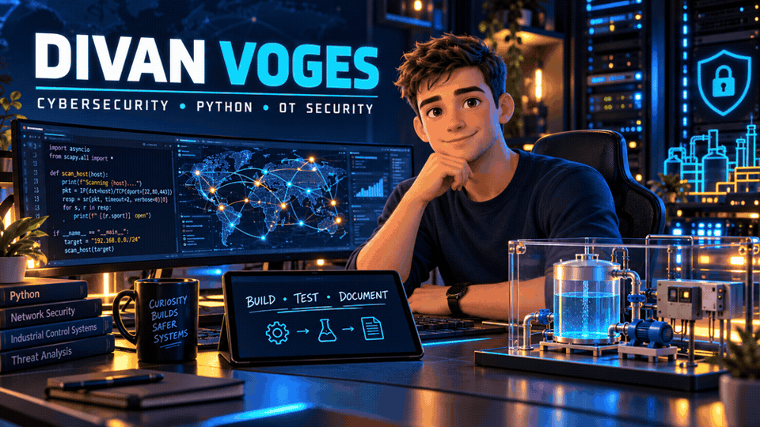

# Divan Voges
### Cybersecurity Student | Python Projects | Network and OT Security

I am pursuing a B.S. in Cybersecurity at the University of the District of Columbia, maintaining a 4.0 GPA with an expected graduation date of December 2027.

My experience combines technical support, database development, academic research, and practical security projects. I am interested in security engineering, network defense, and operational technology security, and I am seeking cybersecurity and IT internships.

[LinkedIn](https://www.linkedin.com/in/divanv) · [Project Repositories](https://github.com/Voooges?tab=repositories)

## Featured Projects

| Project | Description | Demonstrated Skills | Status |
|---|---|---|---|
| [Python TCP Port Scanner](https://github.com/Voooges/python-port-scanner) | Checks selected TCP ports on localhost. Includes port validation, connection timeouts, and error handling. Results were compared with Nmap. | Python, sockets, argparse, TCP networking, testing | Initial version completed |
| [Python Failed Login Analyzer](https://github.com/Voooges/failed-login-analyzer) | Analyzes synthetic SSH logs, counts failed logins by IPv4 address, and flags configurable review thresholds. Verified five test cases. | Python, regular expressions, Counter, log analysis, input validation | Initial version completed |
| OT Simulation and Monitoring Lab | Built an isolated simulation with a live dashboard for observing simulated process conditions. Exploring network traffic analysis with Wireshark. | System integration, dashboard development, monitoring, technical documentation | In progress |
| Cybersecurity Research | Authored a literature-based paper examining risk management frameworks, firewalls, and intrusion detection. Presented findings at UDC Research Week. | Literature review, security control analysis, research writing, presentations | Completed |
| Hack The Box and Virtual Labs | Configured Kali Linux in VirtualBox and completed the Meow lab, practicing service enumeration and identifying insecure Telnet access. | Linux, Nmap, virtualization, authentication security fundamentals | Continuing practice |

### Project Documentation

My completed Python projects include source code, setup instructions, saved test output, and documented limitations. They were developed with guided assistance and tested in local lab environments.

The OT simulation description covers only general project experience. Confidential capstone objectives, research findings, and implementation details are not published.

## Technical Skills

| Area | Technologies and Experience |
|---|---|
| Programming | Python, Java, SQL, JavaScript |
| Python project development | Sockets, argparse, regular expressions, Counter, file processing, exception handling |
| Operating systems and labs | Linux, Kali Linux, VirtualBox |
| Security tools | Nmap, Wireshark |
| Databases | MySQL, Microsoft SQL Server |
| Technical support | Hardware, software, network connectivity, and printer troubleshooting |
| Research and documentation | Literature reviews, security control comparisons, technical writing, presentations |
| Portfolio development | GitHub repositories, Markdown documentation, test evidence |

## Professional Experience

| Organization | Role | Experience |
|---|---|---|
| Gijima | Technical Support | Troubleshot hardware, software, network, and printer issues for end users. Resolved more than 95% of support tickets without escalation. |
| Revolution IoT | Database Development Intern | Supported database design and legacy system maintenance, collaborated with developers, and resolved user-reported database issues. |

## Education and Recognition

| Detail | Information |
|---|---|
| University | University of the District of Columbia |
| Degree | B.S. Cybersecurity |
| Expected graduation | December 2027 |
| Cumulative GPA | 4.0 |
| Academic honors | Dean’s List and Highest Honors every semester |
| Special recognition | Top Freshman, Top Sophomore, and Top Junior |
| Additional education | Software and Web Development qualification; Technical Support qualification |

## Current Development

| Focus | Learning Goals |
|---|---|
| CompTIA Security+ | Preparing for the SY0-701 exam |
| Python for cybersecurity | Strengthening scripting, log processing, and testing skills |
| Network security | Practicing enumeration, traffic analysis, and interpretation of network behavior |
| Security monitoring | Developing an understanding of detection logic and investigation |
| OT and ICS security | Building knowledge through coursework, research, and isolated simulation |

## Contact

I welcome opportunities to contribute to cybersecurity and IT teams while learning from experienced professionals.

- **LinkedIn:** [linkedin.com/in/divanv](https://www.linkedin.com/in/divanv)
- **GitHub:** [github.com/Voooges](https://github.com/Voooges)
  
